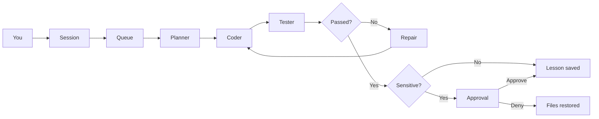

<p align="center">
  
</p>

<h1 align="center">Valta</h1>

<p align="center">
  A local companion that remembers, researches, and builds software.<br>
  One terminal. Chat first. The crew when there is work.
</p>

<p align="center">
  
  
  
</p>

Valta is a control center for a self-hosted coding companion. You talk to it in plain language. It keeps what it learns, looks things up on its own, and can plan, write, test, and repair a project in the folder you started it from. Sensitive work waits until you approve it.

Memory, books, fine-tunes, and your private root rules stay on disk. They are not part of this repository.

## Control center

Chat takes the whole screen. When the crew has work, an Activity panel slides in on the right. Close it with Esc and it stays closed until something new needs a look.

```
 valta                              ● teacher Qwen2.5-Coder-7B   ● personal qwen2.5-coder:3b

 ❯ Build me a calculator                    │ Activity (1)  Changes  Memory  Models  Approvals
   Queued work a1b2c3d4: Build me a ca…     │
                                            │ ● Build me a calculator
                                            │   running · a1b2c3d4
                                            │   planner  short plan
 ⠹ coder  Build me a calculator             │   coder    write_file calc.py
                                            │   tester   exit 0
 ❯ Ask anything, or give Valta an objective │
 ctrl+p pause   ctrl+x stop   ctrl+o activity
```

| Panel | What you see |
| --- | --- |
| Activity | Each job with its status, and planner, coder, tester and reviewer in order. |
| Changes | Changed files and a colored unified diff. |
| Memory | Lessons, research notes, and facts already stored. |
| Models | Which server is up, and which model is loaded. |
| Approvals | A verified self-improvement, or a deploy, waiting for you. |

The top bar shows whether each model server is up. The line above the prompt shows what the crew is doing right now. The line under the prompt lists only the keys that matter at that moment.

| Key | Action |
| --- | --- |
| Ctrl+O | Open or close the Activity panel |
| F1–F5 | Activity, Changes, Memory, Models, Approvals |
| Esc | Close the panel |
| Up / Down | Earlier messages you typed |
| PgUp / PgDn | Scroll the chat |
| Ctrl+P | Pause the running job |
| Ctrl+R | Resume |
| Ctrl+X | Stop. Files stay as they are. |
| Ctrl+A | Keep a verified self-improvement or accept a deploy |
| Ctrl+D | Restore the previous files |
| Ctrl+Q | Quit |

On a terminal narrower than 100 columns the panel takes the whole screen instead of sharing it. Colors come from `ui_theme` in `config.toml`: `tokyo-night` (default), `nord`, `gruvbox`, `dracula`, `catppuccin-mocha`, `textual-light`, or any other Textual theme. Setting the `VALTA_THEME` environment variable overrides it for one run.

A normal build does not stop for approval. Changing Valta’s own code does, and so does a deploy. Approve keeps the edits in the project. Deny puts the previous files back. Nothing is pushed.

## How a job moves



The same root rules are injected ahead of every model call. A role prompt and a retrieved memory do not replace them. Valta will not edit or delete that file, and it will not push git or leave the project folder unless you ask.

## Two models

Ollama cannot split one model across an NVIDIA card and an AMD card. Valta runs two local servers that share one model folder.

| Role | Default model | Where it runs |
| --- | --- | --- |
| Teacher | Qwen2.5-Coder-7B-Instruct Q4_K_M | Port 11434, Vulkan. Research, planning, coding, review. |
| Embeddings | `nomic-embed-text` | Port 11434, with the teacher. |
| Personal | `qwen2.5-coder:3b`, later `valta` | Port 11435, CUDA. Conversation about you, after a fine-tune. |

The 7B stays the model that researches and writes code. The 3B is the one that can be fine-tuned on a 6GB card. After `ollama create valta`, personal conversation can route to that model. Coding and research stay on the teacher, with memory in the prompt.

Hosts, context length, research limits, and the training threshold live in `config.toml`.

## Quick start

Python 3.11 or newer, and [Ollama](https://ollama.com). On the machine this was built for, quit the Ollama tray app first so port 11434 can be bound to the AMD card.

```powershell
py -3.13 -m venv .venv
.\.venv\Scripts\python.exe -m pip install -e ".[dev]"
copy rules\root.example.md rules\root.md
copy data\interests.example.txt data\interests.txt
.\scripts\start-ollama.ps1
.\.venv\Scripts\valta.exe models pull
.\.venv\Scripts\valta.exe
```

`rules\root.md` is yours. Add private lines there. That file is gitignored.

Then talk to it:

```text
Build me a calculator.
```

Work is written into the folder you launched from. Books and research go into local memory, not into that folder. To build somewhere else, start Valta from that directory.

Training extras, when you want a real QLoRA run on the smaller card. Install a CUDA build of PyTorch first (pytorch.org has the current command). A plain `pip install torch` on Windows gives the CPU build, and training will stop with a message saying so.

```powershell
.\.venv\Scripts\python.exe -m pip install -e ".[train]"
.\.venv\Scripts\valta.exe eval        # score the current personal model first
.\.venv\Scripts\valta.exe train
```

GGUF conversion uses llama.cpp’s `convert_hf_to_gguf.py`, found via `LLAMA_CPP_CONVERT`, `PATH`, or a clone in `%LOCALAPPDATA%\llama.cpp`:

```powershell
git clone --depth 1 https://github.com/ggml-org/llama.cpp "$env:LOCALAPPDATA\llama.cpp"
```

Do not install llama.cpp's own requirements file into this venv: it pins a CPU-only PyTorch. The converter writes Q8_0.

If a run stops after training (the merged weights are in `data/merged`), `valta train --resume` converts, scores and promotes them without training again. `valta train --rollback` restores the previous Modelfile, or the base model when there is none.

## Commands

Opening `valta` with no command is the control center. The commands below are there when you want one shot from a shell.

| Command | What it does |
| --- | --- |
| `valta` | Open the control center. |
| `valta models pull` | Pull the teacher, the embedding model, and the personal base. |
| `valta doctor` | Check both servers and which model is loaded. |
| `valta ingest path` | Read a PDF, EPUB, TXT, or Markdown file, or a folder of them. |
| `valta work "goal"` | Plan, edit, test, and repair. `--project` chooses the folder. |
| `valta improve "goal"` | Same loop, pointed at Valta’s own code. Root rules and memory stay protected. |
| `valta research` | One research cycle, capped by `research_page_cap`. |
| `valta memory` | List stored records. |
| `valta forget <id>` | Delete one record and its vector. |
| `valta rules` | Print the root rules that are loaded. |
| `valta eval` | Score a model on the coding eval. `--teacher` scores the 7B instead. |
| `valta practice` | The teacher sets coding problems, tests check the answers, and what the 3B gets wrong is saved for training. `--count` sets how many to try, `--train` fine-tunes afterwards. |
| `valta train` | Build pairs, QLoRA the 3B, score it, and replace `valta` only if it did not get worse. `--skip-eval` promotes without scoring. `--resume` picks up from merged weights. `--rollback` goes back one model. |

From the chat itself, Valta can decide to ingest a path you mention, research a topic, or start a job. You do not have to switch commands.

## What it keeps

SQLite (`data/valta.db`) is the source of truth. Chroma (`data/chroma`) stores vectors for the same records, embedded with `nomic-embed-text`. Kinds are book, research, chat, fact, and lesson.

Background research starts with the control center. It waits so your first message gets the GPU, then rotates through a topic queue, `data/interests.txt`, and headings from books you have ingested. Notes keep the source URL.

Fine-tuning does not train on raw books. It builds question-and-answer pairs from corrections, verified solutions, research notes, and a small sample of book chunks. Research notes are capped at 20, one per topic (the newest), with any leading "Note:" label removed, so background reading cannot outnumber corrections and verified work. Pairs that conflict with the root rules are dropped. The system text of each pair is the current root rules.

Two kinds of example are saved as you work:

- **Corrections.** Start a message with `correction:` and the right answer. A bare "no, that's wrong" is not saved, because it does not say what the right answer is.
- **Verified solutions.** When a job passes its tests and the reviewer says PASS, the goal and the files it wrote are saved. Jobs that change Valta's own code are skipped, since those wait for your approval and can be denied.

Two more are logged for later kinds of training, and are not used by `valta train` yet:

- **Transcripts.** Every crew job outside Valta's own folder keeps its planner input and plan, and each coder round untrimmed: every action, every result, the tests and the reviewer's verdict (`transcripts` table).
- **Preference pairs.** A correction keeps the reply it replaced, and a job that failed and was then repaired keeps the failed files next to the passing ones (`preference_pairs` table). These are the better-and-worse pairs that preference training (DPO) needs.

Every fine-tune starts again from the base model, so each run trains on all examples ever saved, not only the new ones. Training uses the model's own chat template and learns only from the answer. The root rules at the top of each pair are masked out. Examples longer than `train_max_len` tokens are skipped instead of cut.

## Public datasets

A public instruction dataset on Hugging Face can be mixed in, for example [BAAI/Infinity-Instruct](https://huggingface.co/datasets/BAAI/Infinity-Instruct). It is streamed, so only the records read are downloaded, and only the ones that pass the filters are kept.

```powershell
.\.venv\Scripts\hf.exe auth login                                            # once, for gated datasets
.\.venv\Scripts\valta.exe dataset peek BAAI/Infinity-Instruct --config 7M -n 5
.\.venv\Scripts\valta.exe dataset import BAAI/Infinity-Instruct --config 7M --ability code --limit 2000
.\.venv\Scripts\valta.exe dataset list
.\.venv\Scripts\valta.exe dataset remove BAAI/Infinity-Instruct:7M
```

- Gated datasets (Infinity-Instruct is one) need you to log in on the dataset page, accept its conditions, and sign in here with your own token.
- `peek` shows each record's language, labels and first question, so you can pick `--ability` words. `--ability` matches any word in the record's labels and can be repeated. `--lang` defaults to `en`. `--scan` caps how many records are read.
- Conversations are converted to user and assistant turns, and the dataset's own system prompts are dropped, because the root rules are the system message of every pair. Training learns from the last answer. Records longer than `train_max_len`, that overlap an eval task, or that conflict with the root rules are skipped.
- They are stored apart from your own examples, in the `external_examples` table, and do not count toward `train_threshold`. Each fine-tune mixes in at most `external_max_pairs` (default 2000).
- Check the dataset's license and the licenses of what it was built from before training on it. Infinity-Instruct is CC BY-SA 4.0 with its own conditions, and draws on other datasets with their own terms.
- A 6 GB card trains a few thousand examples in a night, not millions. Qwen2.5-Coder-3B-Instruct was already instruction-tuned on data like this, so expect small gains from a narrow, relevant slice. The eval gate still decides whether the result replaces `valta`.

## Practice

`valta practice` is how it improves without you in the loop. For each problem:

1. The teacher invents a small Python problem and tests for it.
2. The tests have to fail against a function that does nothing, and the problem must not resemble an eval task.
3. The teacher solves it again from the text alone. If its solution does not pass its own tests, the problem is thrown away. Two separate writings agreeing through a test is the check that the problem is sound.
4. The personal model tries the same problem. If it already passes, nothing is learned and the problem is dropped.
5. If it fails, the teacher's verified solution is saved as a training example.

```powershell
.\.venv\Scripts\valta.exe practice --count 30
.\.venv\Scripts\valta.exe practice --count 30 --train
```

`--train` runs the normal fine-tune afterwards once enough examples are waiting, with the same eval gate. Run it overnight or from Task Scheduler and it keeps going without you. The teacher works on the RX 6600 and the check on the GTX 1660, so they do not fight over one card.

What this can and cannot do:

- The 3B can get as good as the 7B is at what tests can check. It cannot get better than the 7B, and the 7B does not improve by itself here.
- Most problems get dropped. Expect a small share of each run to become examples, and expect hundreds before a fine-tune changes much.
- The tests are written by the same model that solves the problems. The agreement check and the stub check remove most bad problems, not all of them.
- Model-written code is run in a temporary folder with a timeout. Code that opens files, starts processes, uses the network or reads the keyboard is refused before it runs. That stops honest mistakes. It is not a sandbox against code written to get around it.

## Does it get better?

`valta eval` asks a model for twelve small Python functions at temperature 0 and runs each reply against hidden asserts. Add your own tasks as JSON in `data/evals/` (`[{"id", "prompt", "tests"}]`; `tests` runs after `from solution import *`). Training pairs that contain an eval prompt are dropped, so the eval stays a fair test.

`valta train` scores the current personal model, trains, loads the result as `valta-candidate`, and scores it. It replaces `valta` only if the new score is at least the old one minus `eval_tolerance`. The default is 0, so the new model has to match or beat the old score. With twelve tasks, any tolerance below about 0.09 still means no lost task is allowed, and 0.1 lets a model that lost one task through. Scores are kept in `data/state.json` under `eval_history`.

Limits worth knowing:

- Twelve tasks is a small sample, so one task is about 8 points. Treat a single run as a hint and look at the history.
- It measures coding, not personal conversation, which is what the 3B is routed for. It catches regressions. It does not prove the personal model got better at knowing you.
- Replies are run as Python in a temporary folder with a 10 second timeout and a clean environment. That is not a sandbox, the same trust level as the test runs the crew already does.

## What stays off GitHub

| Stays local | Why |
| --- | --- |
| `data/valta.db`, `data/chroma/` | Chat, facts, lessons, and vectors. |
| `data/library/` | Ingested books and notes. |
| `data/datasets/`, `data/adapters/`, `data/merged/`, `data/models/` | Training sets, LoRA weights, and GGUF files. |
| `data/state.json` | Which personal model is active, and the rollback Modelfile. |
| `data/interests.txt` | Your research list. |
| `rules/root.md` | Your private constitution. |
| `.env`, keys, tokens | Credentials. |

`rules/root.example.md` and `data/interests.example.txt` are the public starters. Copy them, then edit the copies. The copies are ignored.

## Layout

```text
valta/
├── config.toml              hosts, models, limits
├── rules/root.example.md    public starter for the constitution
├── scripts/start-ollama.ps1 two local Ollama servers
├── valta/                   the package
│   ├── ui.py                terminal control center
│   ├── chat.py              one conversation, several kinds of work
│   ├── engineer.py          planner, coder, tester, reviewer
│   ├── jobs.py              queue, diffs, pause, stop, approval
│   ├── memory.py            SQLite
│   ├── vectors.py           Chroma
│   ├── research.py          background research
│   ├── practice.py          self-set problems, verified by tests
│   ├── evals.py             the coding eval and the promotion gate
│   ├── ingest.py            PDF, EPUB, TXT, Markdown
│   └── train.py             QLoRA and ollama create
└── tests/
```

## Tests

```powershell
.\.venv\Scripts\python.exe -m pytest -q
```
