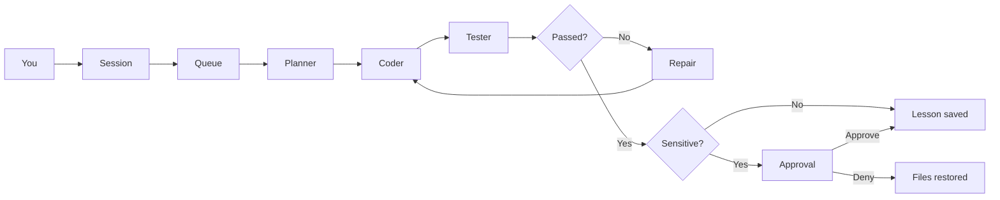

<p align="center">
  
</p>

<h1 align="center">Valta</h1>

<p align="center">
  A local companion that remembers, researches, and builds software.<br>
  One terminal. Chat first. The crew when there is work.
</p>

<p align="center">
  
  
  
</p>

Valta is a control center for a self-hosted coding companion. You talk to it in plain language. It keeps what it learns, looks things up, and can plan, write, test, and repair a project in the folder you started it from. Sensitive work waits until you approve it.

Memory, books, fine-tunes, and your private root rules stay on disk. They are not part of this repository.

## Control center

Chat takes the whole screen. When the crew has work, an Activity panel slides in on the right. Close it with Esc and it stays closed until something new needs a look.

```
 valta                              ● teacher qwen3.6:35b        ● personal qwen2.5-coder:3b

 ❯ Build me a calculator                    │ Activity (1)  Changes  Memory  Models  Approvals
   Queued work a1b2c3d4: Build me a ca…     │
                                            │ ● Build me a calculator
                                            │   running · a1b2c3d4
                                            │   planner  short plan
 ⠹ coder  Build me a calculator             │   coder    write_file calc.py
                                            │   tester   exit 0
 ❯ Ask anything, or give Valta an objective │
 ctrl+p pause   ctrl+x stop   ctrl+o activity
```

| Panel | What you see |
| --- | --- |
| Activity | Each job with its status, and planner, coder, tester and reviewer in order. |
| Changes | Changed files and a colored unified diff. |
| Memory | Lessons, research notes, and facts already stored. |
| Models | Which server is up, and which model is loaded. |
| Approvals | A verified change to Valta's own code, waiting for you. |

The top bar shows whether each model server is up. The line above the prompt shows what the crew is doing right now. The line under the prompt lists only the keys that matter at that moment.

| Key | Action |
| --- | --- |
| Ctrl+O | Open or close the Activity panel |
| F1–F5 | Activity, Changes, Memory, Models, Approvals |
| Esc | Close the panel |
| Up / Down | Earlier messages you typed |
| PgUp / PgDn | Scroll the chat |
| Ctrl+P | Pause the running job |
| Ctrl+R | Resume |
| Ctrl+X | Stop. Files stay as they are. |
| Ctrl+A | Keep a verified change to Valta's own code |
| Ctrl+D | Restore the previous files |
| Ctrl+Q | Quit |

On a terminal narrower than 100 columns the panel takes the whole screen instead of sharing it. Colors come from `ui_theme` in `config.toml`: `tokyo-night` (default), `nord`, `gruvbox`, `dracula`, `catppuccin-mocha`, `textual-light`, or any other Textual theme. Setting the `VALTA_THEME` environment variable overrides it for one run.

A normal build does not stop for approval. Changing Valta’s own code does. Approve keeps the edits in the project. Deny puts the previous files back. Nothing is pushed.

## How a job moves



The planner and the coder both see a map of the project: every file, and for each Python file its line count, classes and functions (test files show how many tests they hold). The map is capped at about 8,000 characters; on a large project, argument lists go first, then outlines. The coder changes a file that exists by replacing one block copied exactly from it, which has to match once, and writes a whole file only to create it or when the file is short.

`native_tools` in `config.toml` chooses how the coder acts. Set to `true`, it calls `read_file`, `list_directory`, `search_memory`, `replace`, `write_file`, `run_tests` and `done` through Ollama's tool calling, one call per turn. Set to `false`, it writes `ACTION` blocks that Valta parses. Valta reads an `ACTION` block in either mode, so a model that slips back into the text format still works. Thinking is turned off on every model call, because Valta reads each reply as the answer itself.

The same root rules are injected ahead of every model call. A role prompt and a retrieved memory do not replace them. Valta will not edit or delete that file, and it will not push git or leave the project folder unless you ask.

## Two models

Ollama cannot split one model across an NVIDIA card and an AMD card. Valta runs two local servers that share one model folder.

| Role | Default model | Where it runs |
| --- | --- | --- |
| Teacher | `qwen3.6:35b` | Port 11434, Vulkan on the RX 6600, experts in system RAM. Research, planning, coding, review. |
| Embeddings | `nomic-embed-text` | Port 11434, with the teacher. |
| Personal | `qwen2.5-coder:3b`, later `valta` | Port 11435, CUDA. Conversation about you, after a fine-tune. |

The teacher researches and writes code. The 3B is the one that can be fine-tuned on a 6GB card. After `ollama create valta`, personal conversation can route to that model. Coding and research stay on the teacher, with memory in the prompt.

### Choosing the teacher

`qwen3.6:35b` is a mixture-of-experts model: 35B parameters, about 3B of them used per token. Ollama puts about 5 GB of it on the RX 6600 and leaves the experts in system RAM, file-mapped, so it fits beside the personal model and training on the GTX 1660. It needs about 17 GB of free RAM; with 32 GB, a training run and the teacher can share the machine, and Windows drops mapped pages it needs back.

Measured on this machine (HumanEval+ through `valta eval --plus`; speed from a 2,300-token coding prompt):

| Teacher | HumanEval+ | Where | Context | Writing | Reading the prompt |
| --- | --- | --- | --- | --- | --- |
| `qwen3.6:35b` | 148/164 (90.2%) | RX 6600 + system RAM | 32K | 27 tok/s | 86 tok/s |
| `qwen2.5-coder:14b` | 146/164 (89.0%) | both cards (combined mode) | 8K | 19 tok/s | 169 tok/s |
| Qwen2.5-Coder-7B Q4_K_M | 135/164 (82.3%) | RX 6600 | 32K | 40 tok/s | 240 tok/s |
| `qwen2.5-coder:3b` (personal base) | 131/164 (79.9%) | GTX 1660 | 32K | | |

At 32K context the 14B only fit 80% on the two cards and wrote 7 tok/s. The 35B reads long prompts more slowly than the 7B, but Ollama keeps the start of a conversation cached, so a crew job mostly pays for what is new each round.

Hosts, context length, research limits, and the training threshold live in `config.toml`.

`model_options` in `config.toml` is sent with every model call, under the call's own context size and temperature. It sets `presence_penalty = 0.0`: Qwen3.5 ships with 1.5, which pushes the model away from tokens it has just used, and code reuses names and symbols all the time. Qwen2.5 ships with no penalty, so the setting changes nothing for it.

### Both cards for one model (combined mode)

Through Vulkan, one Ollama server can see the RX 6600 and the GTX 1660 together, about 14 GB, and spread a model across them. That fits a teacher neither card holds alone, such as `qwen2.5-coder:14b` (about 9 GB at 4-bit).

```powershell
.\scripts\stop-ollama.ps1
.\scripts\start-ollama.ps1 -Mode combined
ollama pull qwen2.5-coder:14b
ollama run qwen2.5-coder:14b "hi"
ollama ps                                      # PROCESSOR should read 100% GPU
.\.venv\Scripts\valta.exe eval --teacher --model qwen2.5-coder:14b
```

If the eval beats the current teacher, set `teacher_model` in `config.toml` to it. Go back with `stop-ollama.ps1`, then `start-ollama.ps1` with no mode. Measured here, the 14B lost to `qwen3.6:35b`, which needs no combined mode (see Choosing the teacher).

- In combined mode there is no server on 11435: no personal model, and `valta train`, `valta practice` and plain `valta eval` stop with a message. Chat falls back to the teacher.
- Training cannot use both cards. PyTorch drives NVIDIA through CUDA and AMD through ROCm, one training run cannot mix them, and the RX 6600 has no supported PyTorch on Windows. Training stays on the GTX 1660, in separate mode.
- Splitting a model across two cards over PCIe is slower than one card holding it. The 14B answered at half the 7B's speed.
- `ollama ps` showing a CPU share means the model did not fit in the two cards' memory. `data\logs\ollama-combined.err.log` lists how many layers went to each device.

## Quick start

Python 3.11 or newer, and [Ollama](https://ollama.com). On the machine this was built for, quit the Ollama tray app first so port 11434 can be bound to the AMD card.

```powershell
py -3.13 -m venv .venv
.\.venv\Scripts\python.exe -m pip install -e ".[dev]"
copy rules\root.example.md rules\root.md
copy data\interests.example.txt data\interests.txt
.\scripts\start-ollama.ps1
.\.venv\Scripts\valta.exe models pull
.\.venv\Scripts\valta.exe
```

`rules\root.md` is yours. Add private lines there. That file is gitignored.

Then talk to it:

```text
Build me a calculator.
```

Work is written into the folder you launched from. Books and research go into local memory, not into that folder. To build somewhere else, start Valta from that directory.

Training extras, when you want a real QLoRA run on the smaller card. Install a CUDA build of PyTorch first (pytorch.org has the current command). A plain `pip install torch` on Windows gives the CPU build, and training will stop with a message saying so.

```powershell
.\.venv\Scripts\python.exe -m pip install -e ".[train]"
.\.venv\Scripts\valta.exe eval        # score the current personal model first
.\.venv\Scripts\valta.exe train
```

GGUF conversion uses llama.cpp’s `convert_hf_to_gguf.py`, found via `LLAMA_CPP_CONVERT`, `PATH`, or a clone in `%LOCALAPPDATA%\llama.cpp`:

```powershell
git clone --depth 1 https://github.com/ggml-org/llama.cpp "$env:LOCALAPPDATA\llama.cpp"
```

Do not install llama.cpp's own requirements file into this venv: it pins a CPU-only PyTorch. The converter writes Q8_0.

Training saves its progress every `checkpoint_steps` steps (default 25, about 25 minutes on the GTX 1660). If a run stops, `valta train --resume` continues the newest one from wherever it got to: from the last checkpoint, from the finished adapter if the merge did not happen, or from the merged weights if conversion did not happen. It trains on the exact dataset that run started with.

`valta train --benchmark 8` trains eight steps on the last training set in a scratch folder and prints seconds per step and peak GPU memory, then deletes everything. Use it to try a setting, such as a lower `train_max_len`, before committing a night to a run.

Training leaves the frozen word-embedding table in 16-bit. peft's usual preparation converts it to 32-bit, which costs about 0.6 GB on a 6 GB card for weights that never train. Only the small norm weights go to 32-bit. `train_fp32_embeddings = true` in `config.toml` restores peft's behaviour if a run ever trains unstably.

`valta train --max-examples 500` makes a shorter run: imported-dataset pairs are trimmed first, and your own corrections and verified work are always kept. The eval scores of the current model and the base model are remembered with their Ollama digests, so a model that has not changed since it was last scored is not scored again, which saves about ten minutes each. `valta train --rollback` restores the previous Modelfile, or the base model when there is none.

## Commands

Opening `valta` with no command is the control center. The commands below are there when you want one shot from a shell.

| Command | What it does |
| --- | --- |
| `valta` | Open the control center. |
| `valta models pull` | Pull the teacher, the embedding model, and the personal base. |
| `valta doctor` | Check both servers and which model is loaded. |
| `valta ingest path` | Read a PDF, EPUB, TXT, or Markdown file, or a folder of them. |
| `valta work "goal"` | Plan, edit, test, and repair. `--project` chooses the folder. |
| `valta improve "goal"` | Same loop, pointed at Valta’s own code. Root rules and memory stay protected. |
| `valta research` | One research cycle, capped by `research_page_cap`. |
| `valta memory` | List stored records. |
| `valta forget <id>` | Delete one record and its vector. |
| `valta rules` | Print the root rules that are loaded. |
| `valta eval` | Score a model on the coding eval. `--teacher` scores the teacher instead. `--plus` runs HumanEval+ on the teacher's server instead, `--plus --mbpp` runs MBPP+. |
| `valta practice` | The teacher sets coding problems, tests check the answers, and what the 3B gets wrong is saved for training. `--count` sets how many to try, `--train` fine-tunes afterwards. |
| `valta train` | Build pairs, QLoRA the 3B, score it, and replace `valta` only if it scores at least as well as both the current model and the stock 3B. `--skip-eval` promotes without scoring. `--resume` picks up from merged weights. `--rollback` goes back one model. |

From the chat itself, Valta can decide to ingest a path you mention, research a topic, or start a job. You do not have to switch commands.

## What it keeps

SQLite (`data/valta.db`) is the source of truth. Chroma (`data/chroma`) stores vectors for the same records, embedded with `nomic-embed-text`. Kinds are book, web, research, chat, fact, and lesson.

Research runs when you ask for it: `valta research`, a request in chat, or `valta learn` for a site you choose. Background research is off by default (`research_interval_sec = 0`), because left running every few minutes it filed near-identical notes on one topic. Set it to a number of seconds to turn it back on: it waits so your first message gets the GPU, then rotates through a topic queue, `data/interests.txt`, and headings from books you have ingested. Notes keep the source URL.

After each reply, the exchange is queued and read for durable facts about you on a background thread, so the reply does not wait for that extra model call. Exchanges that pile up while the model is busy are read together in one call, and at most three facts are kept per exchange.

Fine-tuning does not train on raw books or research notes. It builds question-and-answer pairs from corrections, verified solutions, practice problems, imported datasets, and a small sample of book and web passages. Research notes stay in memory, where chat and the crew look them up. Pairs that conflict with the root rules are dropped. The system text of each pair is the current root rules.

Two kinds of example are saved as you work:

- **Corrections.** Start a message with `correction:` and the right answer. A bare "no, that's wrong" is not saved, because it does not say what the right answer is.
- **Verified solutions.** When a job passes its tests and the reviewer says PASS, the goal and the files it wrote are saved. Jobs that change Valta's own code are skipped, since those wait for your approval and can be denied.

Two more are logged for later kinds of training, and are not used by `valta train` yet:

- **Transcripts.** Every crew job outside Valta's own folder keeps its planner input and plan, and each coder round untrimmed: every action, every result, the tests and the reviewer's verdict (`transcripts` table).
- **Preference pairs.** A correction keeps the reply it replaced, and a job that failed and was then repaired keeps the failed files next to the passing ones (`preference_pairs` table). These are the better-and-worse pairs that preference training (DPO) needs.

Every fine-tune starts again from the base model, so each run trains on all examples ever saved, not only the new ones. Training uses the model's own chat template and learns only from the answer. The root rules at the top of each pair are masked out. Examples longer than `train_max_len` tokens are skipped instead of cut.

## Learning from websites

`valta learn` reads a documentation site into memory:

```powershell
.\.venv\Scripts\valta.exe learn https://docs.python.org/3/library/pathlib.html --pages 30
```

- It stays on the same site and under the same path (a start of `/3/library/pathlib.html` reads under `/3/library/`), reads only HTML, drops `?query` and `#fragment` duplicates, and stops at `--pages` (at most 500).
- It follows robots.txt, including `Crawl-delay`, and waits `--delay` seconds (default 1) between requests. It never logs in or sends cookies.
- It keeps the page's `<main>` or `<article>` text when there is one, so menus and footers are left out. Pages are stored as kind `web` with their URL, and a page already learned is skipped next time.
- What it learns is used at once: chat and the crew search memory before answering. Training also turns the newest book and web passages into questions, `doc_qa_pairs` of them (default 20), each one a teacher call when the run starts.
- What you point it at is your call. Prefer documentation that allows reuse, and stay within each site's terms.

## Public datasets

A public instruction dataset on Hugging Face can be mixed in, for example [BAAI/Infinity-Instruct](https://huggingface.co/datasets/BAAI/Infinity-Instruct). It is streamed, so only the records read are downloaded, and only the ones that pass the filters are kept.

```powershell
.\.venv\Scripts\hf.exe auth login                                            # once, for gated datasets
.\.venv\Scripts\valta.exe dataset peek BAAI/Infinity-Instruct --config 7M -n 5
.\.venv\Scripts\valta.exe dataset import BAAI/Infinity-Instruct --config 7M --ability code --min-answer 200 --code-only --limit 2000
.\.venv\Scripts\valta.exe dataset list
.\.venv\Scripts\valta.exe dataset remove BAAI/Infinity-Instruct:7M
```

- Gated datasets (Infinity-Instruct is one) need you to log in on the dataset page, accept its conditions, and sign in here with your own token.
- `--min-answer 200` skips conversations whose final answer is shorter than 200 characters, such as one-line "describe this function" replies. `--code-only` keeps only answers that contain code. In a first import of Infinity-Instruct's code slice, about half the answers were one-liners.
- `peek` shows each record's columns, language, labels and first question, so you can pick filters. `--ability` matches any word in the record's labels and can be repeated. `--where COLUMN=TEXT` keeps records whose column contains the text, such as `--where lang=python` or `--where source=wildchat`; repeat it to keep records that match any. `--scan` caps how many records are read.
- `--lang` defaults to `en`. It is checked against a record's `langdetect` field; for datasets without one, English is judged from the prose, with code set aside, since many datasets mix languages.
- Records can be ShareGPT `conversations`, chat `messages`, or one question and one answer column: `instruction`/`response`, `instruction` + `input`/`output`, `query`/`answer`, `problem`/`solution`, `question`/`answer`, `prompt`/`completion`. Bare code in an answer gets a fence.
- `scripts\import-datasets.ps1` imports the current mix, picked from Hugging Face's most-downloaded instruction datasets: tested Python answers (KodCode, self-oss-instruct, OpenCoder), code edits (InstructCoder), harder requests (CodeFeedback, Magicoder, Python only), and English conversation from tulu-3. Each line in it names the dataset's license.
- Conversations are converted to user and assistant turns, and the dataset's own system prompts are dropped, because the root rules are the system message of every pair. Training learns from the last answer. Records longer than `train_max_len`, that overlap an eval task, or that conflict with the root rules are skipped.
- They are stored apart from your own examples, in the `external_examples` table, and do not count toward `train_threshold`. Each fine-tune mixes in at most `external_max_pairs` (default 2000).
- Check the dataset's license and the licenses of what it was built from before training on it. Infinity-Instruct is CC BY-SA 4.0 with its own conditions, and draws on other datasets with their own terms.
- A 6 GB card trains a few thousand examples in a night, not millions. Qwen2.5-Coder-3B-Instruct was already instruction-tuned on data like this, so expect small gains from a narrow, relevant slice. The eval gate still decides whether the result replaces `valta`.

## Practice

`valta practice` is how it improves without you in the loop. For each problem:

1. The teacher invents a small Python problem and tests for it.
2. The tests have to fail against a function that does nothing, and the problem must not resemble an eval task.
3. The teacher solves it again from the text alone. If its solution does not pass its own tests, the problem is thrown away. Two separate writings agreeing through a test is the check that the problem is sound.
4. The personal model tries the same problem. If it already passes, nothing is learned and the problem is dropped.
5. If it fails, the teacher's verified solution is saved as a training example.

```powershell
.\.venv\Scripts\valta.exe practice --count 30
.\.venv\Scripts\valta.exe practice --count 30 --train
```

`--train` runs the normal fine-tune afterwards once enough examples are waiting, with the same eval gate. Run it overnight or from Task Scheduler and it keeps going without you. The teacher works on the RX 6600 and the check on the GTX 1660, so they do not fight over one card.

What this can and cannot do:

- The 3B can get as good as the teacher is at what tests can check. It cannot get better than the teacher, and the teacher does not improve by itself here. With `qwen3.6:35b` (90% on HumanEval+ against the 3B's 80%) there is room between them.
- Most problems get dropped. Expect a small share of each run to become examples, and expect hundreds before a fine-tune changes much.
- The tests are written by the same model that solves the problems. The agreement check and the stub check remove most bad problems, not all of them.
- Model-written code is run in a temporary folder with a timeout. Code that opens files, starts processes, uses the network or reads the keyboard is refused before it runs. That stops honest mistakes. It is not a sandbox against code written to get around it.

## Does it get better?

`valta eval` asks a model for twelve small Python functions at temperature 0 and runs each reply against hidden asserts. Add your own tasks as JSON in `data/evals/` (`[{"id", "prompt", "tests"}]`; `tests` runs after `from solution import *`). Training pairs that contain an eval prompt are dropped, so the eval stays a fair test.

`valta train` scores the current personal model and the base model (`self_model`, the stock 3B), trains, loads the result as `valta-candidate`, and scores it. It replaces `valta` only if the new score is at least the better of those two scores minus `eval_tolerance`. The default is 0, so the new model has to match or beat both. Comparing with the current model alone let losses add up: a fine-tune promoted one task worse became the bar the next one only had to tie. With twelve tasks, any tolerance below about 0.09 still means no lost task is allowed, and 0.1 lets a model that lost one task through. Scores are kept in `data/state.json` under `eval_history`.

Limits worth knowing:

- Twelve tasks is a small sample, so one task is about 8 points. Treat a single run as a hint and look at the history.
- It measures coding, not personal conversation, which is what the 3B is routed for. It catches regressions. It does not prove the personal model got better at knowing you.
- Replies are run as Python in a temporary folder with a 10 second timeout and a clean environment. That is not a sandbox, the same trust level as the test runs the crew already does.

### A harder test for choosing a model

Strong models pass all twelve tasks, so the twelve cannot tell two teachers apart. `valta eval --plus` runs [HumanEval+](https://github.com/evalplus/evalplus): 164 tasks, each checked against many more inputs than the original HumanEval. `--mbpp` runs MBPP+ instead, 378 tasks and a much longer run.

EvalPlus brings its own transformers, datasets and API clients, so it gets its own venv, away from the training packages. Install it once. The pinned commit fixes a bug in the 0.3.1 release that fails HumanEval/32 for every model, and its build needs a version number because GitHub's archive has no git history:

```powershell
py -3.13 -m venv .venv-eval
$env:SETUPTOOLS_SCM_PRETEND_VERSION = "0.3.2.dev0"
.\.venv-eval\Scripts\python.exe -m pip install "evalplus @ https://github.com/evalplus/evalplus/archive/26d6d00bb1fd0fa37f39c99d5290da67891d1c5e.zip"
.\.venv\Scripts\valta.exe eval --plus                           # the teacher in config.toml
.\.venv\Scripts\valta.exe eval --plus --model qwen2.5-coder:14b  # another model on the same server
```

Valta runs EvalPlus with the Python in `VALTA_EVALPLUS_PYTHON` when that is set, otherwise `.venv-eval`, otherwise its own venv if EvalPlus is installed there.

- It runs on the teacher's server (port 11434) by default, so it can run while the GTX 1660 trains. `--personal` uses port 11435 instead; leave that until training has finished.
- Valta asks the model for each task at temperature 0, with the root rules first and EvalPlus's own instruction. EvalPlus then cleans each reply with its sanitizer and runs its base and extra tests, through `scripts/evalplus_run.py`.
- The headline number is the share of tasks that pass both the base and the extra tests. The base-only share is printed beside it.
- Each run keeps its replies and EvalPlus's verdicts in `data/evalplus/<time>-<dataset>-<model>/`, and adds one line to `data/evalplus/history.jsonl`. The end of each run lists earlier runs, so models can be compared. These scores never go into `eval_history`, and the promotion gate inside `valta train` still uses the twelve tasks.
- EvalPlus limits each test input with a Unix timer that Windows does not have, which would fail every task. `scripts/evalplus_run.py` swaps in a timer thread on Windows and turns off EvalPlus's Unix-only memory limit.
- On Windows with Python 3.13, EvalPlus's own reference answer to HumanEval/32 misses one extra test by a rounding error, so 163 of 164 is the practical top score.
- Like the twelve-task eval, this runs model-written code on your machine with a timeout. It is not a sandbox.

## What stays off GitHub

| Stays local | Why |
| --- | --- |
| `data/valta.db`, `data/chroma/` | Chat, facts, lessons, and vectors. |
| `data/library/` | Ingested books and notes. |
| `data/datasets/`, `data/adapters/`, `data/merged/`, `data/models/` | Training sets, LoRA weights, and GGUF files. |
| `data/evalplus/` | HumanEval+ and MBPP+ replies and scores. |
| `data/state.json` | Which personal model is active, and the rollback Modelfile. |
| `data/interests.txt` | Your research list. |
| `rules/root.md` | Your private constitution. |
| `.env`, keys, tokens | Credentials. |

`rules/root.example.md` and `data/interests.example.txt` are the public starters. Copy them, then edit the copies. The copies are ignored.

## Layout

```text
valta/
├── config.toml              hosts, models, limits
├── rules/root.example.md    public starter for the constitution
├── scripts/start-ollama.ps1 two local Ollama servers
├── scripts/evalplus_run.py  EvalPlus's checker, run from .venv-eval
├── valta/                   the package
│   ├── ui.py                terminal control center
│   ├── chat.py              one conversation, several kinds of work
│   ├── engineer.py          planner, coder, tester, reviewer
│   ├── repomap.py           the project map the planner and coder see
│   ├── jobs.py              queue, diffs, pause, stop, approval
│   ├── memory.py            SQLite
│   ├── vectors.py           Chroma
│   ├── research.py          web research, on request
│   ├── practice.py          self-set problems, verified by tests
│   ├── evals.py             the coding eval and the promotion gate
│   ├── plus_eval.py         HumanEval+ and MBPP+ through EvalPlus
│   ├── ingest.py            PDF, EPUB, TXT, Markdown
│   └── train.py             QLoRA and ollama create
└── tests/
```

## Tests

```powershell
.\.venv\Scripts\python.exe -m pytest -q
```
