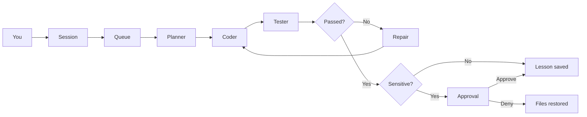

<p align="center">
  
</p>

<h1 align="center">Valta</h1>

<p align="center">
  A local companion that remembers, researches, and builds software.<br>
  One terminal. Chat on the left. The crew on the right.
</p>

<p align="center">
  
  
  
</p>

Valta is a control center for a self-hosted coding companion. You talk to it in plain language. It keeps what it learns, looks things up on its own, and can plan, write, test, and repair a project in the folder you started it from. Sensitive work waits until you approve it.

Memory, books, fine-tunes, and your private root rules stay on disk. They are not part of this repository.

## Control center

```
┌ Session ──────────────────────┐ ┌ Operations ─────────────────────────┐
│ You    Build me a calculator. │ │ Live   Diff   Jobs   Memory        │
│ Valta  Queued with the crew.  │ │ Models Approvals                    │
│                               │ │                                     │
│                               │ │ planner   short plan                │
│                               │ │ coder     write_file calc.py        │
│                               │ │ tester    exit 0                    │
│                               │ │ reviewer  PASS                      │
└───────────────────────────────┘ └─────────────────────────────────────┘
 Tell Valta an objective, or ask a question
 Pause   Stop   Approve   Deny
```

| Pane | What you see |
| --- | --- |
| Session | The conversation. An objective such as “Build me a calculator.” is enough. |
| Live | Planner, coder, tester, and reviewer, in order, with the model on that step. |
| Diff | Changed files, a unified diff, and `git diff` when the folder is a repository. |
| Jobs | The queue. Progress, pause, resume, and stop. |
| Memory | Lessons, research notes, and facts already stored. |
| Models | Which server is up, and which model is loaded. |
| Approvals | A verified self-improvement, or a deploy, waiting for you. |

| Key | Action |
| --- | --- |
| F1–F6 | Live, Diff, Jobs, Memory, Models, Approvals |
| Ctrl+P | Pause the running job |
| Ctrl+R | Resume |
| Ctrl+X | Stop. Files stay as they are. |
| Ctrl+A | Keep a verified self-improvement or accept a deploy |
| Ctrl+D | Restore the previous files |

A normal build does not stop for approval. Changing Valta’s own code does, and so does a deploy. Approve keeps the edits in the project. Deny puts the previous files back. Nothing is pushed.

## How a job moves



The same root rules are injected ahead of every model call. A role prompt and a retrieved memory do not replace them. Valta will not edit or delete that file, and it will not push git or leave the project folder unless you ask.

## Two models

Ollama cannot split one model across an NVIDIA card and an AMD card. Valta runs two local servers that share one model folder.

| Role | Default model | Where it runs |
| --- | --- | --- |
| Teacher | Qwen2.5-Coder-7B-Instruct Q4_K_M | Port 11434, Vulkan. Research, planning, coding, review. |
| Embeddings | `nomic-embed-text` | Port 11434, with the teacher. |
| Personal | `qwen2.5-coder:3b`, later `valta` | Port 11435, CUDA. Conversation about you, after a fine-tune. |

The 7B stays the model that researches and writes code. The 3B is the one that can be fine-tuned on a 6GB card. After `ollama create valta`, personal conversation can route to that model. Coding and research stay on the teacher, with memory in the prompt.

Hosts, context length, research limits, and the training threshold live in `config.toml`.

## Quick start

Python 3.11 or newer, and [Ollama](https://ollama.com). On the machine this was built for, quit the Ollama tray app first so port 11434 can be bound to the AMD card.

```powershell
py -3.13 -m venv .venv
.\.venv\Scripts\python.exe -m pip install -e ".[dev]"
copy rules\root.example.md rules\root.md
copy data\interests.example.txt data\interests.txt
.\scripts\start-ollama.ps1
.\.venv\Scripts\valta.exe models pull
.\.venv\Scripts\valta.exe
```

`rules\root.md` is yours. Add private lines there. That file is gitignored.

Then talk to it:

```text
Build me a calculator.
```

Work is written into the folder you launched from. Books and research go into local memory, not into that folder. To build somewhere else, start Valta from that directory.

Training extras, when you want a real QLoRA run on the smaller card:

```powershell
.\.venv\Scripts\python.exe -m pip install -e ".[train]"
.\.venv\Scripts\valta.exe train
```

GGUF conversion uses llama.cpp’s `convert_hf_to_gguf.py` via `LLAMA_CPP_CONVERT` or `PATH`. `valta train --rollback` restores the previous Modelfile.

## Commands

Opening `valta` with no command is the control center. The commands below are there when you want one shot from a shell.

| Command | What it does |
| --- | --- |
| `valta` | Open the control center. |
| `valta models pull` | Pull the teacher, the embedding model, and the personal base. |
| `valta doctor` | Check both servers and which model is loaded. |
| `valta ingest path` | Read a PDF, EPUB, TXT, or Markdown file, or a folder of them. |
| `valta work "goal"` | Plan, edit, test, and repair. `--project` chooses the folder. |
| `valta improve "goal"` | Same loop, pointed at Valta’s own code. Root rules and memory stay protected. |
| `valta research` | One research cycle, capped by `research_page_cap`. |
| `valta memory` | List stored records. |
| `valta forget <id>` | Delete one record and its vector. |
| `valta rules` | Print the root rules that are loaded. |
| `valta train` | Build pairs, QLoRA the 3B, then `ollama create valta`. |

From the chat itself, Valta can decide to ingest a path you mention, research a topic, or start a job. You do not have to switch commands.

## What it keeps

SQLite (`data/valta.db`) is the source of truth. Chroma (`data/chroma`) stores vectors for the same records, embedded with `nomic-embed-text`. Kinds are book, research, chat, fact, and lesson.

Background research starts with the control center. It waits so your first message gets the GPU, then rotates through a topic queue, `data/interests.txt`, and headings from books you have ingested. Notes keep the source URL.

Fine-tuning does not train on raw books. It builds question-and-answer pairs from corrections, research notes, and a small sample of book chunks. Pairs that conflict with the root rules are dropped. The system text of each pair is the current root rules.

## What stays off GitHub

| Stays local | Why |
| --- | --- |
| `data/valta.db`, `data/chroma/` | Chat, facts, lessons, and vectors. |
| `data/library/` | Ingested books and notes. |
| `data/datasets/`, `data/adapters/`, `data/merged/`, `data/models/` | Training sets, LoRA weights, and GGUF files. |
| `data/state.json` | Which personal model is active, and the rollback Modelfile. |
| `data/interests.txt` | Your research list. |
| `rules/root.md` | Your private constitution. |
| `.env`, keys, tokens | Credentials. |

`rules/root.example.md` and `data/interests.example.txt` are the public starters. Copy them, then edit the copies. The copies are ignored.

## Layout

```text
valta/
├── config.toml              hosts, models, limits
├── rules/root.example.md    public starter for the constitution
├── scripts/start-ollama.ps1 two local Ollama servers
├── valta/                   the package
│   ├── ui.py                terminal control center
│   ├── chat.py              one conversation, several kinds of work
│   ├── engineer.py          planner, coder, tester, reviewer
│   ├── jobs.py              queue, diffs, pause, stop, approval
│   ├── memory.py            SQLite
│   ├── vectors.py           Chroma
│   ├── research.py          background research
│   ├── ingest.py            PDF, EPUB, TXT, Markdown
│   └── train.py             QLoRA and ollama create
└── tests/
```

## Tests

```powershell
.\.venv\Scripts\python.exe -m pytest -q
```
